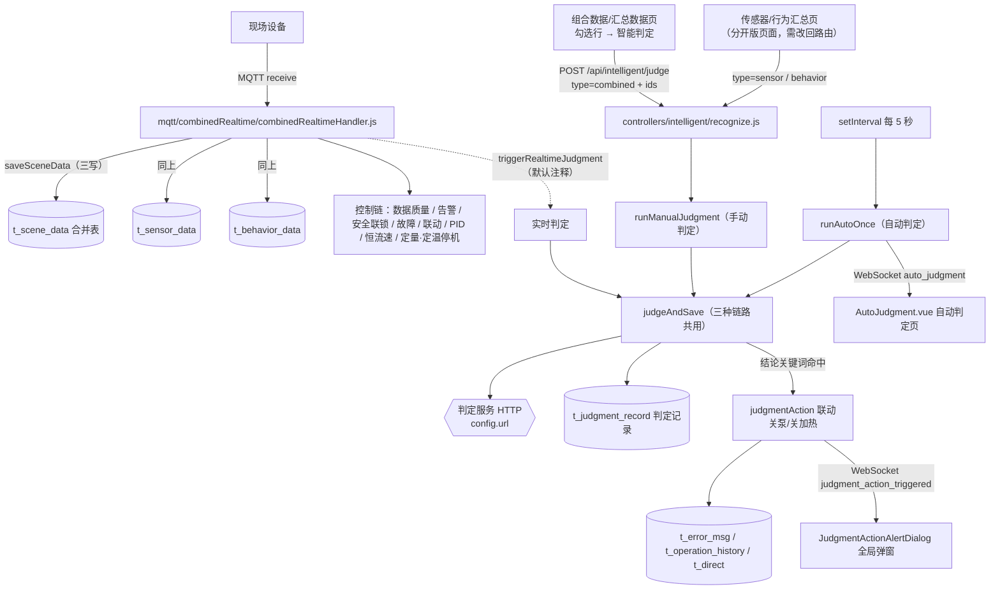

# 智能判定（判定服务对接）使用手册

> 适用版本：**"合并版"（三表方案）**——一条 MQTT 消息同时写 `t_scene_data`（合并表）+ `t_sensor_data` + `t_behavior_data`。
> 手册同时覆盖 **"合并显示"** 与 **"分开显示"** 两种页面形态下，判定功能分别读哪些数据、发什么报文、怎么开关。
> 涉及的代码位置、配置项、数据库字段、WebSocket 消息、排查方法全部写在这里；现场只改配置不用改代码。

---

## 0. 一分钟速览

智能判定就是"**把数据发给一个会判断正常/异常的 HTTP 服务，拿回结论**"，一共三条触发链路：

| 链路 | 谁触发 | 读哪张表 | 发给判定服务的字段 | 默认开关 |
|---|---|---|---|---|
| **手动判定** | 页面勾选记录 → 点「智能判定」 | 合并显示：`t_scene_data`<br>分开显示：`t_sensor_data` 或 `t_behavior_data` | **合并：传感器 + 行为**<br>分开：只有勾选的那一侧 | 始终可用 |
| **自动判定** | 后端定时器（默认每 5 秒） | `t_sensor_data`（写死在 `runAutoOnce`） | 只有传感器，且是数据库裸槽位名 `field1~field10` | `AUTO_JUDGMENT.enabled` |
| **实时判定** | 每条 MQTT 消息到达 | 内存报文（不回查数据库） | 只有传感器 | `REALTIME_JUDGMENT.enabled`（**代码里调用被注释，默认不发**） |

三种链路最后都汇合到同一个函数 `judgeAndSave()`：**发请求 → 解析结论 → 落库 `t_judgment_record`**，然后（自动/实时）还会把结论交给"判定联动"去关泵/关加热。

> ⚠️ 现在 `INTELLIGENT_JUDGMENT.enabled = false`，所以**并没有真的调你们那台判定服务**，返回的是本地占位结果（`mock: true`）。要接真服务只改这一个配置。

---

## 1. 涉及哪些文件

### 1.1 后端（`backend/server/`）

| 文件 | 职责 | 什么时候需要改 |
|---|---|---|
| `service/intelligent/config.js` | **判定全部参数**：服务地址/超时/字段路径、三种链路的开关与节奏、组合判定字段前缀 | ★现场主要改这里 |
| `service/intelligent/intelligentJudgment.js` | 主链路：`runManualJudgment` / `runAutoOnce` / `runRealtimeJudgment` / `judgeAndSave` / `callService` / `mockResult` / `saveRecord`（建表+落库） | 换数据源、改占位判定算法时 |
| `service/intelligent/combinedJudgment.js` | 把 `t_scene_data` 的槽位还原成"设备上报语义字段名"（`field1→temp_in`、`field11→pump`） | 一般不用改，改字段映射表即可 |
| `controllers/intelligent/recognize.js` | `POST /api/intelligent/judge`（`/api/intelligent/recognize` 同款），参数校验 + 错误码翻译 | 改一次最多判几条（`MAX_IDS`）时 |
| `controllers/intelligent/records.js` | `GET /api/intelligent/records` 判定记录分页查询 | 记录页要加筛选条件时 |
| `service/judgmentAction/config.js` | **判定结论 → 关泵/关加热** 的规则表（关键词 + 动作） | ★现场改规则改这里 |
| `service/judgmentAction/judgmentAction.js` | 规则匹配、冷却、开关下发、写故障记录、弹窗事件 | 一般不用改 |
| `utils/mappedData.js` | `saveSceneData`（一条消息三写）/ `saveMappedData`（分开版遗留）/ `buildMappedRecord` | 改落库规则时 |
| `mqtt/combinedRealtime/combinedRealtimeHandler.js` | 消息主流程：跳变过滤 → 三写 → 控制链 → 每轮汇总日志；底部 `triggerRealtimeJudgment()`（实时判定入口，默认注释） | 要开实时判定时 |
| `routes/sensorRoutes.js` | 路由注册：`/api/intelligent/judge`、`/recognize`、`/records`、`/auto-recent` | 加接口时 |
| `config/systemConfig.js` | 把判定配置拼进 `GET /api/system-config` 给前端用 | 新加前端可见开关时 |
| `config/appSettings.js` | `SHOW_COMBINED_PAGE`（数据菜单是否显示） | 隐藏数据页时 |
| `app.js` | 把判定事件广播成 WebSocket：`auto_judgment`、`realtime_judgment`、`judgment_action_triggered` | 加快捷推送时 |

### 1.2 前端（`src/`）

| 文件 | 职责 |
|---|---|
| `views/CombinedHistory.vue` | **组合数据/汇总数据页**：勾选行 → 「智能判定」按钮（`type=combined`）→ 结果弹窗。按钮受 `showOnCombinedPage` 控制 |
| `views/CombinedRealtime.vue` | 组合数据/实时数据页（判定按钮不在这里，只有卡片和曲线） |
| `views/SensorHistory.vue` / `views/BehaviorHistory.vue` | **分开版的两个汇总页**（当前已停用、路由重定向，文件保留作回退）；它们的判定按钮分别发 `type=sensor` / `type=behavior`，受 `showOnSensorPage` / `showOnBehaviorPage` 控制 |
| `stores/useCombinedStore.js` | 组合页数据源（`GET /api/dataByType?type=combined`） |
| `stores/usePaginationStore.js` | 分开版 4 个页面共用数据源（已停用，保留） |
| `components/JudgmentResultDialog.vue` | 判定结果弹窗外壳，props：`visible` + `result` |
| `components/JudgmentResultPanel.vue` | 弹窗内容：占位判定提示条 + 结论 + 置信度条 + 折叠的原始 JSON |
| `views/AutoJudgment.vue` | **自动判定页**：打开时 `GET /api/intelligent/auto-recent` 补齐历史，之后订阅 WebSocket `auto_judgment`；含置信度折线、结论时间轴、结论分布饼图、结果表格 |
| `views/JudgmentHistory.vue` | **智能判定记录页**：`GET /api/intelligent/records`，可按设备编号/状态/时间范围筛 |
| `components/JudgmentActionAlertDialog.vue` | 判定联动弹窗（全局挂在 `MainLayout`），订阅 `judgment_action_triggered` |
| `components/JudgmentCharts.vue` | 自动判定页的三张图（置信度上限常量在里面） |
| `router/index.js` | 路由：`/combined-realtime`、`/combined-history`、`/auto-judgment`、`/judgment-history`；旧地址 `/sensor-*`、`/behavior-*` 重定向 |
| `components/SideBar.vue` | 菜单：数据组受 `SHOW_COMBINED_PAGE`，判定记录受 `showHistoryMenu`，自动判定受 `AUTO_JUDGMENT.showMenu` |

### 1.3 数据库

| 表 | 在判定里的角色 |
|---|---|
| `t_scene_data` | **合并表**（一条消息一行）：`field1~field10` 传感器槽位、`field11~field20` 行为槽位、`has_sensor`/`has_behavior` 标记。组合判定从这里取数 |
| `t_sensor_data` / `t_behavior_data` | **分开版真表**：传感器/行为各自一份。传感器判定、行为判定、自动判定从这里取数 |
| `t_judgment_record` | **判定记录**：每次判定一行（请求体、响应体、结论、置信度、状态都存下来） |
| `t_sensor_field_mapper` / `t_behavior_field_mapper` | 字段映射：决定"哪个槽位是什么语义"（`db_name` ↔ `p_name` ↔ 页面列名 `f_name`），也决定组合判定报文的字段名 |
| `t_error_msg` | 判定联动命中规则时写的故障记录（`type='智能判定联动'`） |
| `t_operation_history` | 判定联动真正下发了开关动作时写的操作历史 |
| `t_direct` / `t_direct_config` | 指令中心：判定联动通过 `prefix`（pump/heater）读当前值并下发新值 |

---

## 2. 数据流全景



两条要点先记住：

1. **控制链（安全联锁/PID/故障…）与智能判定是两条独立的路**：控制链读的是"这条 MQTT 报文 + 指令中心"，智能判定读的是"数据库里的记录"，两者互不阻塞；判定服务挂了也不会影响控制链。
2. **判定读哪张表，取决于你用哪种显示方式**（见第 4 节），但它们的数据来源都是同一条消息三写出来的，所以内容一致。

---

## 3. 三种触发链路详解

### 3.1 手动判定（页面按钮）

**入口**：`POST /api/intelligent/judge`（`/api/intelligent/recognize` 是同一个控制器，等价）

| 项 | 说明 |
|---|---|
| 请求体 | `{ "type": "combined" \| "sensor" \| "behavior", "ids": [117027, 117028] }` |
| `ids` 含义 | 合并显示：`t_scene_data.id`（一行 = 一条消息）<br/>分开显示：`t_sensor_data.id` 或 `t_behavior_data.id` |
| 条数上限 | `recognize.js` 的 `MAX_IDS = 100`（前端全选几百条会被截断） |
| 取数 | `runManualJudgment()`：`SELECT * FROM <表> WHERE id IN (...)`，`type=combined` 时再走 `toCombinedPayloadRecords()` 还原字段名 |
| 成功响应 | `{ success: true, data: { results, conclusion, confidence, mock }, message }` |
| 错误码 | 404 查不到数据 / 502 判定服务报错或响应非 JSON / 504 判定服务超时 |
| 落库 `status` | 真服务 `success`，占位判定 `mock`，失败 `failed` |

前端按钮位置：`views/CombinedHistory.vue`（`type: 'combined'`，见第 7 节代码）。**手动判定不会触发联动动作**——它只是"追溯历史数据"，结论照样落库，但不会真去关泵/关加热。

### 3.2 自动判定（后端定时器）

| 项 | 说明 |
|---|---|
| 开关 | `AUTO_JUDGMENT.enabled`（`service/intelligent/config.js`），默认 `true` |
| 节奏 | `intervalMs`（默认 5000，最快按 1000 算），上一轮没判完会跳过这一轮并打警告 |
| 每次条数 | `recentCount`（默认 5，范围 1~100） |
| 内存缓冲 | `bufferSize`（默认 50，范围 1~500）：结果存内存供 `/api/intelligent/auto-recent` 回放 |
| **取数（重点）** | `runAutoOnce()` 里**写死**：`SELECT * FROM t_sensor_data ORDER BY c_time DESC, id DESC LIMIT ?`，且 `judgeAndSave({ type: 'sensor' })` → **只有传感器数据，且字段是裸槽位名 `field1~field10`** |
| 落库 `status` | `auto` / `auto_mock` / `failed` |
| 推送 | 每轮 `events.emit('auto_judgment', entry)` → `app.js` 广播给前端 |
| 影响页面 | `views/AutoJudgment.vue`（统计"每 X 秒提交最新 N 条传感器数据"）、菜单项受 `AUTO_JUDGMENT.showMenu` |

⚠️ **两个坑**：
1. 自动判定要判"行为+传感器"必须改代码（`runAutoOnce` 的数据源），见第 9.1 节；
2. 它按 `c_time DESC` 取"最新 N 条"，**如果设备时钟不准（例如上报 2005 年），它会取到旧数据**——设备 RTC 要校准，或把 `config/protocol.js` 的 `TIME_FIELDS` 里的 `Time` 去掉改用服务器时间。

### 3.3 实时判定（每条消息）

| 项 | 说明 |
|---|---|
| 开关 | `REALTIME_JUDGMENT.enabled`（默认 `false`） |
| 触发点 | `combinedRealtimeHandler.js` 底部的 `triggerRealtimeJudgment(info)`——**当前这行调用被注释掉了**，所以即使开关打开也不会触发，要开必须把注释解开 |
| 取数 | 用内存里的原始报文经 `buildMappedRecord()` 映射（**不回查数据库**，所以消息还没落库也能判）；只映射传感器侧 |
| 落库 `status` | `realtime` / `realtime_mock` / `failed`（`source_ids` 存 `null`，因为消息还没入库没有自增 id） |
| 推送 | `events.emit('realtime_judgment', entry)` → `app.js` 广播类型 `realtime_judgment`（**目前前端没有页面订阅这个类型**，想用需要自己加消费方） |
| 压力 | 每条消息一次 HTTP，判定服务压力最大，只在需要秒级判定时开 |

### 3.4 三条链路的共同环节：`judgeAndSave()`

```js
judgeAndSave({ type, records, statusPair, ids })
  ├─ callService(records)      → 组装 { [requestField]: records } POST 给判定服务
  ├─ summarize(responseData)   → 按 resultPath / conclusionPath / confidencePath 取结论
  ├─ saveRecord(...)           → 写 t_judgment_record（成功/占位/失败都写）
  └─ triggerJudgmentAction()   → 命中关键词就关泵/关加热（手动判定不调用这一步）
```

**失败也落库**：任何异常都会写一条 `status='failed'` 的记录（`error_message` 存原因），方便事后查。

---

## 4. ★ 两种显示方式下的判定差异

数据在库里是**三份**（合并表 + 传感器表 + 行为表，一条消息三写），所以"页面怎么显示"和"判定读哪张表"是**两件可以分开决定的事**。下表是当前生效的形态：

### 4.1 合并显示（当前生效，推荐）

| 项 | 内容 |
|---|---|
| 页面 | 菜单「组合数据」→ `实时数据` = `/combined-realtime`、`汇总数据` = `/combined-history` |
| 数据接口 | `GET /api/dataByType?type=combined&...` |
| 从哪张表取 | `t_scene_data`（单表查询，无 JOIN），列名带前缀：`传感器·进水温度`、`行为·水泵` |
| 实时窗口 | `has_sensor = 1 AND has_behavior = 1` 的最新 5 条（"完整的消息"） |
| 判定按钮 | `CombinedHistory.vue` 的「智能判定」，发 `{ type:'combined', ids }` |
| 判定取数 | `t_scene_data` 整行 → `toCombinedPayloadRecords()` 还原字段名 |
| **发给判定服务的字段** | **传感器 + 行为都有**：`temp_in / temp_out / flow / pressure / pump / heater / mode` |
| 判定记录 `data_type` | `combined` |
| 按钮显隐开关 | `INTELLIGENT_JUDGMENT.showOnCombinedPage`（不配则跟随 `showOnSensorPage`） |
| 旧地址 | `/sensor-realtime`、`/sensor-history`、`/behavior-*` → 重定向到上面两个页面（不会 404） |

**真实样例**（点一次「智能判定」后端落库的 `request_body`）：
```json
[ { "d_no": "202606", "c_time": "2005-01-01 00:14:47",
    "temp_in": "24.6", "temp_out": "25.9", "flow": "0", "pressure": "1.4",
    "mode": "0", "heater": "0", "pump": "0" } ]
```

### 4.2 分开显示（回退形态，代码都还在）

| 项 | 内容 |
|---|---|
| 页面 | `传感器数据/实时数据` `/sensor-realtime`、`传感器数据/汇总数据` `/sensor-history`、`行为数据/实时数据` `/behavior-realtime`、`行为数据/汇总数据` `/behavior-history`（**当前只保留文件与重定向**） |
| 数据接口 | `GET /api/dataByType?type=sensor` / `?type=behavior` |
| 从哪张表取 | `t_sensor_data` / `t_behavior_data`（**真表**，与合并表同时写入） |
| 判定按钮 | `SensorHistory.vue` → `{ type:'sensor', ids }`；`BehaviorHistory.vue` → `{ type:'behavior', ids }` |
| 判定取数 | `SELECT * FROM t_sensor_data / t_behavior_data WHERE id IN (...)` |
| **发给判定服务的字段** | **只有那一侧，且是数据库整行**：`id / d_no / field1~field10 / c_time / online`（裸槽位名，没有 `temp_in` 这种语义名） |
| 判定记录 `data_type` | `sensor` / `behavior` |
| 按钮显隐开关 | `showOnSensorPage`（默认 `true`）、`showOnBehaviorPage`（默认 `false`） |

**真实样例**（自动判定落库的 `request_body`，与手动传感器判定同形）：
```json
[ { "id": 113331, "d_no": "202606", "field1": "37.7", "field2": "38.1", "field3": "0", "field4": "1.3",
    "field5": null, "field6": null, "field7": null, "field8": null, "field9": null, "field10": null,
    "c_time": "2026-09-18 17:34:01", "online": "保存数据" } ]
```

### 4.3 对比一眼看

| 维度 | 合并显示 | 分开显示 |
|---|---|---|
| 判定类型 | `type=combined` | `type=sensor` / `type=behavior` |
| 数据表 | `t_scene_data` | `t_sensor_data` / `t_behavior_data` |
| 报文含行为数据 | ✅ 有（pump/heater/mode） | ❌ 传感器模式下没有 |
| 报文字段名 | **语义名**（映射表 `p_name`：`temp_in`、`pump`…） | **裸槽位名**（`field1`…`field10`） |
| 报文附带字段 | `d_no`、`c_time` | 还多带 `id`、`online` |
| 一行对应 | 一条完整消息 | 传感器/行为各自一行 |
| 判定记录 `data_type` | `combined` | `sensor` / `behavior` |
| 适合什么赛题 | 要求"结合传感器与运行状态综合判定" | 只判传感器数据是否异常 |

> **给判定服务的建议**：如果你的服务能同时接受"语义名"和"裸槽位名"，两种形态都不用改；如果只认一种，建议**统一用 `combined`**（语义名可读性更好），按第 9.1 节把自动/实时判定也切过去。

### 4.4 两种形态怎么切（数据库都不用动）

因为三张表一直在同时写入，**切换只改前端路由/菜单和后端开关**：

**① 从合并 → 分开**

1. `src/router/index.js`：把 4 条 redirect 改回真实页面
   ```js
   { path:'/sensor-realtime',  component:()=>import('@/views/SensorRealtime.vue'),  meta:{ title:'传感器数据/实时数据' } },
   { path:'/sensor-history',   component:()=>import('@/views/SensorHistory.vue'),   meta:{ title:'传感器数据/汇总数据' } },
   { path:'/behavior-realtime',component:()=>import('@/views/BehaviorRealtime.vue'),meta:{ title:'行为数据/实时数据' } },
   { path:'/behavior-history', component:()=>import('@/views/BehaviorHistory.vue'), meta:{ title:'行为数据/汇总数据' } }
   ```
2. `src/components/SideBar.vue`：把数据组拆回"传感器数据 / 行为数据"两组（`index="1"` / `index="2"`），并在 `menuParents` 里登记这 4 个路径的父级 index
3. `backend/server/config/appSettings.js`：`SHOW_COMBINED_PAGE` 改成 `false`（隐藏组合页菜单，但路由仍可访问）
4. `backend/server/service/intelligent/config.js`：按需要调 `showOnSensorPage` / `showOnBehaviorPage` / `showOnCombinedPage`
5. `npm run build`（前端）+ 重启后端（配置改动要重启）

**② 从分开 → 合并**：把上面 5 步反过来即可。

**③ 判定相关的"零改动"保证**：`t_sensor_data` / `t_behavior_data` 的列（14 列）和索引（`PRIMARY`/`idx_c_time`/`idx_d_no`）与合并前完全一致，所以**分开版代码整套搬回来也能直接跑**，不需要动数据库。

### 4.5 混合使用时的注意事项

- **自动判定目前恒定走 `sensor`**（`runAutoOnce` 写死），无论页面是合并还是分开。所以合并显示时，"自动判定页"看到的是**只有传感器的结论**——想让自动判定也带行为数据，见第 9.1 节。
- **手动判定按页面走**：组合页发 `combined`，分开版页面发 `sensor`/`behavior`，二者互不影响。
- 三种 `data_type` 在"智能判定记录"页里是**混在一起**展示的，用「数据类型」列区分。

---

## 5. 发给判定服务的报文契约

### 5.1 全部开关与参数（都在 `service/intelligent/config.js`）

```js
INTELLIGENT_JUDGMENT: {
  enabled: false,            // ★true 才真的请求现场服务；false 走本地占位判定
  mockWhenDisabled: true,    // enabled=false 时是否返回占位结果（true=能跑通流程用于演示）
  showOnSensorPage: true,    // 分开版：传感器汇总页是否显示「智能判定」按钮
  showOnBehaviorPage: false, // 分开版：行为汇总页是否显示按钮
  showOnCombinedPage: true,  // 合并版：组合汇总页是否显示按钮（不写则跟随 showOnSensorPage）
  showHistoryMenu: true,     // 左侧菜单是否显示「智能判定记录」页
  url: 'http://127.0.0.1:5000/judgment', // ★现场服务地址（服务在另一台电脑时改成那台机的局域网 IP）
  method: 'POST',            // 只能用带请求体的方法（要 GET 看 intelligentJudgment.js 的 callService 注释）
  timeoutMs: 10000,          // 单次请求超时（毫秒），超时接口返回 504
  headers: { 'Content-Type': 'application/json' }, // 要 Token 就加 Authorization: 'Bearer xxx'
  requestField: 'data',      // ★请求体里"记录数组"的字段名 → { "data": [ ... ] }
  resultPath: 'data.results',     // ★响应里"结果数组"的点路径，空串表示整个响应就是数组
  conclusionPath: 'result',       // ★单条结果里"结论"字段的点路径，空串表示整条就是一句文字
  confidencePath: 'confidence',   // ★单条结果里"置信度"字段的点路径，空串表示没有置信度
  combinedPrefix: { sensor: '', behavior: '' }, // ★合并判定时给两侧字段加前缀（两边同名时用）
}
```

### 5.2 HTTP 层长什么样

```http
POST http://127.0.0.1:5000/judgment
Content-Type: application/json

{ "data": [ { "d_no":"202606", "c_time":"2005-01-01 00:14:47",
              "temp_in":"24.6", "temp_out":"25.9", "flow":"0", "pressure":"1.4",
              "mode":"0", "heater":"0", "pump":"0" } ] }
```

### 5.3 响应怎么解析（三个点路径）

服务返回下面任意一种形态，**只改配置不改代码**：

| 服务返回 | 要配的路径 |
|---|---|
| `{ "data": { "results": [ { "result": "干烧", "confidence": 0.93 } ] } }` | `resultPath='data.results'`、`conclusionPath='result'`、`confidencePath='confidence'`（默认就是这三个） |
| `{ "results": [ { "conclusion": "漏水", "score": 0.8 } ] }` | `resultPath='results'`、`conclusionPath='conclusion'`、`confidencePath='score'` |
| `[ { "status": "正常" } ]`（顶层就是数组） | `resultPath=''`、`conclusionPath='status'` |
| 直接返回一句中文 `干烧` | `resultPath=''`、`conclusionPath=''`、`confidencePath=''` |

**约定**：结论只取结果数组的**第一条**（这一批记录共用一个结论）；置信度取不到就是 `null`（**`0` 是合法值**，不会被当成"没有"）。

### 5.4 合并判定报文的字段名怎么来的（`combinedJudgment.js`）

```
t_behavior_field_mapper: db_name=field1, p_name='pump'   →  报文里的 pump  = t_scene_data.field11
t_sensor_field_mapper:   db_name=field1, p_name='temp_in'→  报文里的 temp_in = t_scene_data.field1
```

- 只取映射表里 **`visible = 1`** 的行（所以 `pidMode` 那行 `visible=0` 就不会出现在报文里）；
- 字段名取 `p_name` 的**第一个别名**（`p_name` 支持 `A|B|C` 写法，写在前面的优先）；
- **想让判定服务少收到某个字段** → 把对应 mapper 行的 `visible` 改成 `0`（不改代码、不改表结构）；
- **两侧出现同名物理字段**（比如传感器和行为都叫 `flow`）→ 在 `combinedPrefix` 里给两侧加前缀（如 `{ sensor:'s_', behavior:'b_' }`），报文就变成 `s_flow` / `b_flow`。

### 5.5 没接真服务时的"占位判定"

`enabled: false` + `mockWhenDisabled: true` 时，后端不请求任何服务，用 `mockResult()` 本地猜：

- 判定规则：记录里**任何一个测量值**的绝对值 `> 10000` → `数据异常`（置信度 0.9），否则 `正常`（0.8）；
- 阈值改 `intelligentJudgment.js` 里 `mockResult()` 的 `> 10000`；
- 参与判定的字段：除系统字段（`id / d_no / c_time / online / has_sensor / has_behavior / trace_id`）以外的全部键——**所以合并判定的 `temp_in`、`pump` 这些语义名同样有效**；
- 前端弹窗会显示一条黄色提示「本地占位判定（服务未启用，不是真实结果）」，避免误当真实结论。

---

## 6. 判定记录表 `t_judgment_record`

| 字段 | 含义 |
|---|---|
| `id` | 自增主键 |
| `d_no` | 设备编号（取本批第一条记录的设备号） |
| `data_type` | `sensor` / `behavior` / `combined`（哪种判定） |
| `source_ids` | 判了哪几条：`113331,113332`（合并判定存 `t_scene_data.id`；实时判定存 `null`，因为消息还没入库） |
| `request_body` | **真正发给判定服务的请求体**（JSON 文本，排查神器） |
| `response_body` | 判定服务的原始响应（占位判定时存本地结果） |
| `conclusion` | 结论文字（如 `正常` / `干烧`） |
| `confidence` | 置信度（`decimal(8,4)`，没有就是 `NULL`） |
| `status` | 见下表 |
| `error_message` | 失败原因（最多 1000 字） |
| `c_time` | 判定时间（落库时间，不是数据时间） |

### `status` 取值

| status | 含义 |
|---|---|
| `success` | 手动判定 + 真服务成功 |
| `mock` | 手动判定 + 本地占位 |
| `auto` / `auto_mock` | 自动判定（真服务 / 占位） |
| `realtime` / `realtime_mock` | 实时判定（真服务 / 占位） |
| `failed` | 这一轮失败（超时、服务报错、响应非 JSON…），原因在 `error_message` |

「智能判定记录」页（`/judgment-history`）的状态下拉就是按这些值筛的（`success` / `mock` / `failed` / `auto` / `auto_mock` / `realtime` / `realtime_mock`）。

---

## 7. 前端怎么用

### 7.1 组合汇总页：勾选 → 点「智能判定」

`src/views/CombinedHistory.vue` 的核心逻辑：

```js
const handleRecognize = async () => {
  if (selectedRows.value.length === 0) { ElMessage.warning('请先勾选需要判定的组合数据'); return }
  const ids = selectedRows.value.map(item => item.id)     // 行的 id = t_scene_data.id
  const res = await api.post('/api/intelligent/judge', { type: 'combined', ids })
  if (res.data.success) { recognizeResult.value = res.data.data; dialogVisible.value = true }
}
```

按钮显隐（同一文件 `onMounted`）：

```js
const judgment = config.INTELLIGENT_JUDGMENT || {}
showRecognizeBtn.value = (judgment.showOnCombinedPage ?? judgment.showOnSensorPage) === true
```

> 分开版的两个汇总页同理，只是 `type` 换成 `'sensor'` / `'behavior'`，开关换成 `showOnSensorPage` / `showOnBehaviorPage`。
> **想深挖这一跳到底传了什么（对象还是数组、传了哪些字段、怎么变成发给判定服务的报文）→ 见第 13 章。**

### 7.2 判定结果弹窗

`combine` 后的结果对象 `{ results, conclusion, confidence, mock }` 交给 `JudgmentResultDialog` → `JudgmentResultPanel` 渲染：

- `mock === true` → 顶部黄色提示「本地占位判定（服务未启用，不是真实结果）」；
- 结论文字（取不到就提示去检查"结果解析设置"），命中负面关键词（异常/故障/失败/error…）显示红点，否则绿点；
- 置信度进度条：**兼容 0~1 和 0~100 两种约定**（`>1` 当百分比，不再乘 100）；
- 「查看原始响应数据」折叠区展示完整 JSON（含 `results`，用于对齐服务格式）。

### 7.3 自动判定页（`/auto-judgment`）

| 行为 | 实现 |
|---|---|
| 打开页面补齐历史 | `GET /api/intelligent/auto-recent` 取后端内存缓冲（`AUTO_JUDGMENT.bufferSize` 条上限） |
| 之后实时增量 | `wsOn('auto_judgment', append)`，收到就追加（并按 bufferSize 截断） |
| 状态条 | 显示是否启用、间隔秒数、每次几条、已收多少条、最近一次时间 |
| 图表/表格 | `JudgmentCharts`（置信度折线 + 结论时间轴）+ `PieChart`（结论分布）+ 明细表（判定时间/原数据ID/结论/置信度/状态） |
| 状态标签 | `auto`=自动判定（绿）、`auto_mock`=本地模拟（黄）、`failed`=失败（红） |
| 菜单显隐 | `AUTO_JUDGMENT.showMenu` |

### 7.4 判定记录页（`/judgment-history`）

`GET /api/intelligent/records?page&pageSize&d_no&status&startTime&endTime`，列：ID / 设备编号 / 数据类型 / 原数据ID / 判定结论 / 置信度 / 状态 / 错误信息 / 判定时间。
`ID`、`设备编号` 两列跟随全局显示开关（`HIDE_ID_FIELDS` / `HIDE_NUMBER_FIELDS`，见 `config/appSettings.js`）。

### 7.5 菜单显隐一览

| 菜单项 | 开关 |
|---|---|
| 「组合数据」整组（实时/汇总） | `appSettings.SHOW_COMBINED_PAGE` |
| 「传感器数据」「行为数据」两组（分开版） | 现在没有；恢复分开版时由 `SideBar.vue` 里的菜单结构决定 |
| 「智能判定记录」 | `INTELLIGENT_JUDGMENT.showHistoryMenu` |
| 「智能判定（自动）」 | `AUTO_JUDGMENT.showMenu` |

---

## 8. 判定结论 → 自动动作（判定联动）

判定服务给出结论后，可以让系统**自动关泵/关加热**，规则配在 `service/judgmentAction/config.js`：

```js
{
  enabled: false,        // ★总开关：关掉后结论再异常也不动作
  executeActions: true,  // false = 只写记录 + 弹提示，不真的下发开关
  alarmCooldownMs: 30000,// 同一"设备+规则"多久内只触发一次
  requireReset: false,   // true = 触发后锁定设备，需人工点"复位"才解除
  RULES: [
    { id:'dry_burn', name:'干烧', enabled:true,
      keywords:['干烧','无水加热','dry','超温'],
      actions:[{ prefix:'heater', value:'off' }] },              // 干烧 → 只关加热
    { id:'pipe_leak', name:'管道漏水', enabled:true,
      keywords:['漏水','泄漏','leak'],
      actions:[{ prefix:'pump', value:'off' }, { prefix:'heater', value:'off' }] }, // 漏水 → 关泵+关加热
  ],
}
```

执行链路：

```
judgeAndSave（自动/实时判定）
  └─ triggerJudgmentAction(conclusion, record)
       └─ evaluateJudgmentAction → checkRules：结论文字里包含任一 keywords 就命中
            └─ fire：按 actions 里的 prefix/value 通过指令中心下发（setSwitch）
                 ├─ 写 t_operation_history（开关变化）+ t_error_msg（type='智能判定联动'）
                 └─ emit 'judgment_action' → WebSocket judgment_action_triggered → 全局弹窗
```

**四条注意**：

1. **手动判定不触发联动**（它只是追溯历史数据）；`mock` 占位结论也不触发（本地猜的不算数）；
2. 系统处于**故障锁定**期间，联动只写记录、不动开关；
3. `requireReset: true` 时触发后设备被锁定，页面弹窗上点"复位"（`POST /api/judgmentAction/reset`）才解除；
4. `prefix` 必须是指令中心里真实存在的开关 `preffix`（`pump` / `heater`），下发值用 `'on'` / `'off'`。

---

## 9. 现场操作手册（想做什么 → 改哪里）

| 想做什么 | 改哪里 | 改完 |
|---|---|---|
| 接上真实判定服务 | `service/intelligent/config.js` → `INTELLIGENT_JUDGMENT.enabled: true`、`url` | 重启后端 |
| 判定服务在另一台电脑 | 同上 `url` 改成那台机的局域网 IP（如 `http://192.168.1.120:5000/judgment`） | 重启后端 |
| 服务要 GET 而不是 POST | `intelligentJudgment.js` 的 `callService()`（函数上方注释给了 GET / 表单两种写法） | 重启后端 |
| 服务的响应格式和我默认的不一样 | `resultPath` / `conclusionPath` / `confidencePath` | 重启后端 |
| 请求体里数组字段名不是 `data` | `requestField`（如 `'samples'` / `'records'`） | 重启后端 |
| 服务响应慢、老超时 | `timeoutMs` 调大；同时把 `AUTO_JUDGMENT.intervalMs` 调大（避免上一轮没判完就跳过） | 重启后端 |
| 判定频率/每次条数 | `AUTO_JUDGMENT.intervalMs` / `recentCount`（1~100） | 重启后端 |
| 自动判定页最多留多少条结果 | `AUTO_JUDGMENT.bufferSize`（1~500） | 重启后端 |
| 合并判定报文里**不要**某个字段 | 把对应 mapper 行 `visible` 改成 `0`（`UPDATE t_behavior_field_mapper SET visible=0 WHERE p_name='pidMode';`） | 免重启 |
| 合并判定报文字段名要改 | 改 mapper 的 `p_name`（支持 `新名|旧名` 多别名） | 免重启 |
| 两侧出现同名字段要区分 | `combinedPrefix: { sensor:'s_', behavior:'b_' }` | 重启后端 |
| 隐藏某个「智能判定」按钮 | `showOnSensorPage` / `showOnBehaviorPage` / `showOnCombinedPage` | 重启后端 |
| 隐藏「智能判定记录」/「自动判定」菜单 | `showHistoryMenu` / `AUTO_JUDGMENT.showMenu` | 重启后端 |
| 判定结论要自动关泵/关加热 | `service/judgmentAction/config.js` 的 `RULES`（关键词 + 动作），并把 `enabled: true` | 重启后端 |
| 关闭"自动动作"只记录不关泵 | `judgmentAction.executeActions: false` | 重启后端 |
| 占位判定的异常阈值 | `intelligentJudgment.js` 的 `mockResult()` 里 `> 10000` | 重启后端 |
| 整个自动判定关掉 | `AUTO_JUDGMENT.enabled: false` | 重启后端 |
| 隐藏整个数据菜单 | `config/appSettings.js` 的 `SHOW_COMBINED_PAGE: false` | 重启后端 |

### 9.1 ★ 让"自动判定 / 实时判定"也带上行为数据

这两条链路目前只发传感器数据（见第 3.2 / 3.3 节）。要让它们和"手动组合判定"一样发**传感器 + 行为**，改下面两处（数据库不用动）：

**① 自动判定**（`service/intelligent/intelligentJudgment.js` 的 `runAutoOnce`）

```js
// 改成从合并表取"两侧都有值"的最新 N 条，并还原成设备上报语义字段名
const [rows] = await promisePool.query(
  `SELECT * FROM t_scene_data
    WHERE has_sensor = 1 AND has_behavior = 1 AND COALESCE(online, '') <> '补传数据'
    ORDER BY id DESC LIMIT ?`,
  [getRecentCount()]
)
const records = await toCombinedPayloadRecords([...rows].reverse())
const result = await judgeAndSave({ type: 'combined', records, statusPair: AUTO_STATUS, ids })
//                                                                  ↑ 记得显式传 ids：
// toCombinedPayloadRecords 还原出来的记录故意不带 id，不传会得到一堆 undefined
```

> `toCombinedPayloadRecords` 已经在 `intelligentJudgment.js` 顶部 import 过了，直接用。

**② 实时判定**（`mqtt/combinedRealtime/combinedRealtimeHandler.js`）

1. 把文件末尾被注释的那行调用解开：`triggerRealtimeJudgment(info)`；
2. 函数体改成"直接用内存报文"，不要再只映射传感器侧：

```js
function triggerRealtimeJudgment(info) {
    if (!REALTIME_JUDGMENT.enabled) return
    ;(async () => {
        try {
            // info 就是设备上报的原始报文，已经同时含传感器与行为字段
            //（temp_in / pump / heater ...），正好是组合判定要的形状，不用回查数据库。
            // 只把后端自己挂在 info 上的 "_" 开头临时字段去掉（_alarms / _spikeTriggers ...），
            // 免得它们被当成测量值发给判定服务。
            const record = {}
            for (const [key, value] of Object.entries(info)) {
                if (String(key).startsWith('_')) continue
                record[key] = value
            }
            await runRealtimeJudgment({ type: 'combined', record })
        } catch (err) {
            console.error('[CombinedRealtime] 消息实时判定失败:', err.message)
        }
    })()
}
```

> 落库时 `data_type` 会是 `combined`、`source_ids` 为 `null`（消息这一瞬间还没入库、没有自增 id），这是预期行为。
> 如果你更希望"实时判定"发出去的字段名跟数据库槽位一致，也可以先用 `buildMappedRecord()` 映射一遍——但那样还需要拼行为侧，直接用原始报文最省事。

---

## 10. 排查手册

### 10.1 先看日志（后端控制台 / `backend/server/node-out.log`）

| 日志关键字 | 含义 |
|---|---|
| `[Judgment] 判定失败:` | 判定服务报错 / 超时 / 响应非 JSON，后面跟着原因 |
| `[AutoJudgment] 自动判定已启动：每 5000ms 提交最新 5 条传感器数据` | 自动判定启动成功、当前节奏 |
| `[AutoJudgment] 上一轮还没判完，跳过这一轮` | 判定服务比定时器还慢，把 `intervalMs` 调大 |
| `[RealtimeJudgment] 本轮判定失败:` | 实时判定失败 |
| `[CombinedRealtime] 本轮完成 … | 写入 t_scene_data + t_sensor_data + t_behavior_data | 告警0 安全0 …` | **每条消息的落库 + 控制链汇总**，判断"三写有没有生效""控制链有没有跑"最快 |
| `xxx出错，本步跳过，后续步骤继续执行` | 这条消息的某一步抛异常被兜住了（不影响其它步骤），有这行才是真出问题 |
| `[JudgmentAction] 干烧：加热 -> off` | 判定联动真的下发了开关动作 |

### 10.2 SQL 自检

```sql
-- 最近 5 条判定记录（含真正发给服务的请求体）
SELECT id, d_no, data_type, status, source_ids, conclusion, confidence,
       LEFT(request_body, 200) AS req_head, error_message, c_time
FROM t_judgment_record ORDER BY id DESC LIMIT 5;

-- 按状态统计：能看到 mock/success/auto/failed 各多少
SELECT data_type, status, COUNT(*) FROM t_judgment_record GROUP BY data_type, status;

-- 三表是否在同步写入（三写验证）：三个时间的秒应基本一致
SELECT (SELECT MAX(c_time) FROM t_scene_data)   AS scene_max,
       (SELECT MAX(c_time) FROM t_sensor_data)  AS sensor_max,
       (SELECT MAX(c_time) FROM t_behavior_data)AS behavior_max;

-- 合并表里"完整的消息"有多少条
SELECT COUNT(*) FROM t_scene_data WHERE has_sensor = 1 AND has_behavior = 1;
```

### 10.3 接口自测（不通过页面）

```bash
# 取一条组合数据的 id
curl "http://127.0.0.1:3000/api/dataByType?type=combined&page=1&pageSize=1"
# 手动组合判定
curl -X POST http://127.0.0.1:3000/api/intelligent/judge \
     -H "Content-Type: application/json" \
     -d "{\"type\":\"combined\",\"ids\":[117027]}"
# 判定记录
curl "http://127.0.0.1:3000/api/intelligent/records?page=1&pageSize=5"
# 自动判定最近结果（内存缓冲）
curl "http://127.0.0.1:3000/api/intelligent/auto-recent"
```

### 10.4 常见症状对照表

| 症状 | 可能原因 / 处理 |
|---|---|
| 页面上看不到「智能判定」按钮 | ① `showOnCombinedPage` / `showOnSensorPage` 为 `false`；② 没勾选任何行（按钮是灰的）；③ `GET /api/system-config` 失败（前端会兜底 `true`，但配置项读不到） |
| 接口返回 400 `type 必须是 sensor/behavior/combined` | 前端传的 `type` 拼错了，或 `ids` 是空数组 |
| 接口返回 404 `未找到待判定数据` | `ids` 在对应表里不存在（例如拿分开版页面的 id 去发 `type=combined`——两张表的 id 是各自的序列，**不通用**） |
| 接口返回 502 `判定服务返回 HTTP xxx` / `响应不是合法 JSON` | 服务地址/格式不对，或服务内部报错；错误信息里带服务返回的前 300 字 |
| 接口返回 504 `智能判定服务请求超时` | `timeoutMs` 太小或服务太慢 |
| 弹窗显示「（未取到结论，请检查"智能判定"配置里的结果解析设置）」 | `resultPath` / `conclusionPath` 跟服务响应结构不匹配 |
| 弹窗顶部有黄色「本地占位判定」 | `INTELLIGENT_JUDGMENT.enabled = false`（还没接真服务），结论是本地猜的 |
| 自动判定页一直空白 | `AUTO_JUDGMENT.enabled = false`（页面会提示未启用）；或刚启动还没累积到结果（最多等一个 `intervalMs`） |
| 自动判定判的是很久以前的数据 | 它按 `c_time DESC` 取最新 N 条，**设备时钟不准**（如上报 2005 年）就会取到旧数据 → 校准设备 RTC，或把 `config/protocol.js` 的 `TIME_FIELDS` 里 `Time` 去掉 |
| 判定记录里同一个 tick 十几条 `auto_mock` | 自动判定定时器在跑（每 `intervalMs` 一条），属正常；不需要就把 `AUTO_JUDGMENT.enabled` 改 `false` |
| 结论异常但泵/加热没关 | ① `judgmentAction.enabled = false`（默认关）；② 关键词没命中 `RULES[].keywords`；③ 冷却中；④ 处于故障锁定 |
| 判定服务挂了会不会影响采集/控制 | **不会**。判定是独立分支，失败只落一条 `failed` 记录并打日志；控制链照常运行 |

---

## 11. 注意与已知限制

1. **默认不调真服务**：`INTELLIGENT_JUDGMENT.enabled = false` + `mockWhenDisabled = true`，当前跑的是本地占位判定（阈值 `> 10000`）。接真服务只改这一个开关 + `url`。
2. **一次最多判 100 条**（`recognize.js` 的 `MAX_IDS`）。`t_judgment_record.source_ids` 是 `varchar(1000)`，100 个 id 约 700 字符，**不要随意把 `MAX_IDS` 调大**（会截断/报错）。
3. **实时判定目前没接**：`triggerRealtimeJudgment(info)` 那行调用是注释状态；且 `realtime_judgment` 这个 WebSocket 类型**前端暂无页面订阅**（想展示要自己加消费方）。
4. **自动判定固定只发传感器**，且字段是裸槽位名 `field1~field10`（与组合判定的语义名不同）。要与行为数据一起判，按 9.1 节改。
5. **手动判定不触发联动动作**；`mock` 占位结论也不触发。
6. **数据在库里是三份**：判定只读其中一份（`combined` 读 `t_scene_data`；`sensor`/`behavior` 读对应真表）。所以**只有跑"三写"的新代码时，两种显示方式的数据才都是最新的**；若把分开版代码整套跑起来，`t_scene_data` 会停止更新（组合页数据停滞，分开版页面不受影响）。
7. **设备时钟**：合并/分开两种显示下的"实时数据"窗口都按 `id`（不受时钟影响），但**历史图表、汇总页的时间范围筛选、自动判定的取样**都按 `c_time`，设备时钟不对就会漏/取错数据。

---

## 12. 附：一次完整调用（从页面到落库）

1. 打开「组合数据 / 汇总数据」页，勾选 1 行 → 点「智能判定」；
2. 前端：`POST /api/intelligent/judge { type:'combined', ids:[117027] }`
3. 后端：
   - `recognize.js` 校验参数 → `runManualJudgment({ type:'combined', ids:[117027] })`
   - `SELECT * FROM t_scene_data WHERE id IN (117027)` → `toCombinedPayloadRecords()` 还原字段名
   - `judgeAndSave()` → `callService()` 发 `{ "data": [ { d_no, c_time, temp_in, temp_out, flow, pressure, mode, heater, pump } ] }`
   - 解析响应 → `saveRecord()` 写 `t_judgment_record`（`data_type='combined'`、`status='success'` 或 `'mock'`）
4. 前端拿到 `{ results, conclusion, confidence, mock }` → 弹出结果弹窗；
5. 事后核对：
   ```sql
   SELECT data_type, status, conclusion, confidence, request_body, response_body
   FROM t_judgment_record WHERE data_type = 'combined' ORDER BY id DESC LIMIT 1;
   ```

---

## 13. 手动判定：勾选的数据以什么形式传给后端

> 这一章回答一个最常被问的问题：**在「组合数据 / 汇总数据」页勾选几行、点「智能判定」，数据到底是怎么传出去、传的是数组还是对象？**
> 结论：**两跳都是 JSON 对象，数组只是对象里的一个字段**；而且第一跳只传 id，不传行内容。想改传输内容，看 13.3 / 13.5。

### 13.1 先分清"两跳"

| 跳 | 从哪到哪 | 传的内容 | 形态 |
|---|---|---|---|
| ① | 浏览器页面 → 本项目后端 | **只传勾选行的主键 id** + 数据类型 | JSON **对象**，其中一个字段是**数字数组**<br/>`{ "type": "combined", "ids": [117027, 117028] }` |
| ② | 本项目后端 → 现场判定服务 | 后端自己回查数据库、还原字段名后的**完整记录** | JSON **对象**，其中一个字段是**数组**，数组元素才是记录**对象**<br/>`{ "data": [ {记录1}, {记录2} ] }` |

一句话：**前端传的是"我要判哪几条"（id 数组），后端传的是"这几条的完整内容"（记录数组）。**
页面**不会**把表格里勾选的那几行（带中文列名、单位、值映射后的展示值）整体发给后端。

### 13.2 第一跳：页面 → 本项目后端

请求（本地模式，`api` 实例见 `src/api/index.js`）：

```http
POST http://localhost:3000/api/intelligent/judge
Content-Type: application/json      ← axios 对"对象请求体"自动加的（api 实例只额外设了 Cache-Control / Pragma）
Cache-Control: no-cache
Pragma: no-cache

{ "type": "combined", "ids": [117027, 117028] }
```

各环节对应代码：

| 环节 | 位置 |
|---|---|
| 取勾选行、组装并发出请求 | `src/views/CombinedHistory.vue:106-110` |
| 勾选事件把"行对象数组"存进 `selectedRows` | `CombinedHistory.vue:90-92`（`TableContainer` 的 `@selectionChange`） |
| 行里 `id` 的来源 | 查询 SQL 的 `d.id AS id`（`service/tableData/getTableData.js:112`）→ 即 `t_scene_data.id` |
| axios 实例 / baseURL 解析 | `src/api/index.js` + `src/utils/runtimeEndpoint.js:39-50`（本地模式默认 `http://localhost:3000`） |
| 开发期代理 | `vite.config.js:31`（`/intelligent/judge → http://localhost:3000`） |
| 后端路由 | `backend/server/routes/sensorRoutes.js:100`（`/api/intelligent/recognize` 是等价别名） |

```js
// src/views/CombinedHistory.vue
const ids = selectedRows.value.map(item => item.id)   // [117027, 117028]，纯数字数组
const res = await api.post('/api/intelligent/judge', { type: 'combined', ids })
```

> **为什么只传 id（不传整行）**：一行有十几列、还是映射表渲染后的展示值，发过去后端也得反解；交给后端"按 id 回查"更简单，而且能保证判定用的是**数据库里的当前值**，不是页面上那份显示快照。

### 13.3 入口会把 `ids` 再加工一遍（数组内容会被改变）

`controllers/intelligent/recognize.js:58-62`：

```js
const type = req.body?.type
const ids = Array.isArray(req.body?.ids)
  ? [...new Set(req.body.ids.map(Number).filter(Number.isInteger))].slice(0, MAX_IDS)  // MAX_IDS = 100
  : []
if (!TYPE_TABLES[type] || ids.length === 0) {
  return res.status(400).json({ success: false, message: 'type 必须是 sensor/behavior/combined，ids 必须是非空整数数组' })
}
```

| 这一步 | 效果 | 现场含义 |
|---|---|---|
| `map(Number)` | 字符串 id 也接受 | 传 `"117027"` 和 `117027` 一样 |
| `filter(Number.isInteger)` | 丢掉 `null` / `NaN` / 小数 | 坏 id 被静默忽略，不报错 |
| `new Set(...)` | **去重** | 同一行勾两次也只判一次 |
| `slice(0, MAX_IDS)` | **最多 100 条** | 页面全选几百行 → 只判前 100 条（`source_ids` 是 `varchar(1000)`，不能调大） |
| `!TYPE_TABLES[type] \|\| ids.length === 0` | 400 | `type` 只能是 `sensor` / `behavior` / `combined`；`ids` 不能为空 |

> 勾选里混了"库里不存在"的 id 不会报错——`WHERE id IN (...)` 只返回存在的行，不存在的被跳过；**只有一条都查不到**才是 404。

### 13.4 后端拿到 id 之后：回查数据库 + 还原字段名

`service/intelligent/intelligentJudgment.js:319-332`（`runManualJudgment`）：

```js
const table = TYPE_TABLES[type]                      // combined → 't_scene_data'
const placeholders = ids.map(() => '?').join(',')    // [1,2] → "?,?"
const [records] = await promisePool.query(`SELECT * FROM ${table} WHERE id IN (${placeholders}) ORDER BY id`, ids)
if (records.length === 0) { /* error.code='NOT_FOUND' → 404 未找到待判定数据 */ }

// 组合判定：库里一行 = 一条消息，但判定服务要的是"设备上报语义字段名"，先还原
const payloadRecords = type === 'combined' ? await toCombinedPayloadRecords(records) : records
```

| `type` | 查哪张表 | 发出去前的处理 | 最终字段名 |
|---|---|---|---|
| `combined`（组合汇总页） | `t_scene_data`（一行 = 一条完整消息） | 走 `combinedJudgment.js:117-128`：按 `t_sensor_field_mapper` / `t_behavior_field_mapper` 里 `visible=1` 的 `p_name` 还原，行为侧槽位 +10 偏移；保留 `d_no` / `c_time`，**故意不带 `id`** | 语义名 `temp_in / temp_out / flow / pressure / pump / heater / mode` |
| `sensor` / `behavior`（分开版页面，已停用） | `t_sensor_data` / `t_behavior_data` | 原样使用查库结果 | 数据库裸槽位名 `field1 ~ field10` |

> `combined` 的还原记录**不带 `id`**，所以 `runManualJudgment` 必须把原始 `ids` **显式**交给 `judgeAndSave`，否则 `records.map(r => r.id)` 会得到一堆 `undefined`（原因见 `combinedJudgment.js` 文件头第 3 条边界）。

### 13.5 第二跳：本项目后端 → 现场判定服务

`service/intelligent/intelligentJudgment.js:203-238`（`callService`），真正决定形态的是第 211 行：

```js
const body = { [config.requestField]: records }   // requestField 默认 'data' → { "data": [ ... ] }

response = await fetch(config.url, {
  method: config.method,            // 'POST'
  headers: config.headers,          // { 'Content-Type': 'application/json' }
  body: JSON.stringify(body),       // 对象 → JSON 字符串
  signal: controller.signal,        // 超过 timeoutMs → AbortError → 手动接口返回 504
})
```

**固定形态只有一种**：`{ [requestField]: 记录数组 }`，数组元素是记录对象（见 5.2 / 5.4 节）：

```http
POST http://127.0.0.1:5000/judgment
Content-Type: application/json

{ "data": [ { "d_no":"202606", "c_time":"2005-01-01 00:14:47",
              "temp_in":"24.6", "temp_out":"25.9", "flow":"0", "pressure":"1.4",
              "mode":"0", "heater":"0", "pump":"0" } ] }
```

字段名不叫 `data` 时改 `INTELLIGENT_JUDGMENT.requestField`（如 `'samples'` → `{ "samples": [...] }`），代码不用动。

### 13.6 全链路形态对照（一次「智能判定」点下去，数据被改了几次形）

| # | 位置 | 形态 | 具体内容 |
|---|---|---|---|
| 1 | 表格勾选 → 前端内存 | **数组**（Vue 的 `selectedRows`） | el-table 的 selection 数组，元素是整行对象（含中文列名） |
| 2 | 页面 → 后端 `POST /api/intelligent/judge` | **对象**，其中一个字段是数组 | `{ "type":"combined", "ids":[117027,117028] }`，`ids` 只有主键，**没有行内容** |
| 3 | 入口校验后 | 数组（去重/取整/截断后） | `[117027, 117028]`，最长 100 |
| 4 | 后端 → MySQL | SQL 参数数组 | `SELECT * FROM t_scene_data WHERE id IN (?,?) ORDER BY id` |
| 5 | MySQL → 后端 | **数组**，元素是行对象（裸槽位名） | `[{ id:117027, d_no:'202606', field1:'24.6', field11:'0', … }]` |
| 6 | 组合判定还原后 | **数组**，元素是记录对象（语义名、无 id） | `[{ d_no:'202606', c_time:'…', temp_in:'24.6', pump:'0', … }]` |
| 7 | 后端 → 现场判定服务 | **对象**，其中一个字段是数组 | `{ "data": [ {记录1}, {记录2} ] }` |
| 8 | 判定服务 → 后端 | **对象** | 如 `{ "data": { "results":[ { "result":"正常", "confidence":0.9 } ] } }`（按 5.3 的三个点路径解析） |
| 9 | 落库 `t_judgment_record.request_body` / `response_body` | **字符串**（LONGTEXT 里存 JSON 文本） | 上面第 7 / 第 8 步 `JSON.stringify` 后的文本；`source_ids` 是逗号串 `"117027,117028"`（varchar(1000)），**在库里也不是数组** |
| 10 | 后端 → 前端响应 | **对象** | `{ "success":true, "data":{ "results":[…], "conclusion":"正常", "confidence":0.9, "mock":false }, "message":"智能判定完成" }` |
| 11 | 前端弹窗 | **对象** | `res.data.data` → `<JudgmentResultDialog :result>` → `JudgmentResultPanel` 渲染 |

### 13.7 容易搞错的几点

| 误解 | 实际情况 |
|---|---|
| "前端把勾选的行数据（整行）发给后端" | **不是**。前端只发 `ids`；行内容是后端按 id 回查数据库得到的（13.4） |
| "前端发的是数组" | 顶层是**对象** `{ type, ids }`，只有 `ids` 是数组。curl 自测时漏掉 `type` 会 400 |
| "后端发给判定服务的是数组" | 顶层是**对象** `{ [requestField]: [...] }`，数组是它的一个字段值；只有把 `requestField` 用错才会被服务当成非法报文 |
| "`ids` 是行号 / 表格序号" | 是**表主键** `t_scene_data.id`；和分开版的 `t_sensor_data.id` / `t_behavior_data.id` **不通用**（混用 → 404 未找到待判定数据） |
| "表格里显示的中文（比如『水泵：开』）会传出去" | 不会。传出去的是**数据库原值 + 映射表 `p_name` 定义的字段名**，中文展示名是前端渲染时套 `value_map` 得到的 |
| "同一行勾两次会判两次" | 会被 `new Set()` 去重（13.3） |
| "全选 500 行就判 500 行" | 被 `MAX_IDS = 100` 截断，只判前 100 条，**且不会有任何提示** |
| "判定用的一定是页面上看到的那几条数据" | 判定用的是**点按钮那一刻查库的结果**；期间数据被改/删，结果按库里当前值算（删光 → 404） |
| "`request_body` 里存的就是发给服务的原文" | 是 `JSON.stringify` 后的**文本**（LONGTEXT），不是 JSON 类型；`enabled=false` 时它存的是本地 `records` 本身（`judgeAndSave` 的 `service.mock` 分支，`intelligentJudgment.js:279-285`） |

### 13.8 自己验证一遍（不用真判定服务）

```bash
# ① 取一条组合数据的 id（就是表格里勾选那行的 id）
curl "http://127.0.0.1:3000/api/dataByType?type=combined&page=1&pageSize=2"

# ② 模拟页面的请求：对象包数组，只有 id
curl -X POST http://127.0.0.1:3000/api/intelligent/judge \
     -H "Content-Type: application/json" \
     -d "{\"type\":\"combined\",\"ids\":[117027,117028]}"

# ③ 故意漏掉 type → 应回 400
curl -X POST http://127.0.0.1:3000/api/intelligent/judge \
     -H "Content-Type: application/json" -d "{\"ids\":[117027]}"
```

```sql
-- ④ 看第二跳到底发出去什么形态（request_body = { "data": [ … ] } 的 JSON 文本）
SELECT id, data_type, status, source_ids, conclusion, confidence,
       LEFT(request_body, 300) AS req_head, LEFT(response_body, 200) AS resp_head
FROM t_judgment_record ORDER BY id DESC LIMIT 3;
```

> 想看到**真实的第二跳报文**：把 `service/intelligent/config.js` 的 `INTELLIGENT_JUDGMENT.enabled` 改成 `true`、`url` 指向判定服务，再点一次「智能判定」；此时 `request_body` 就是 13.5 节那个 `{ "data": [...] }`，`response_body` 是服务原样返回的内容。
> 服务还没接好时，`enabled=false` 也能验证前两跳：接口照常返回 `{ success:true, data:{ …, mock:true } }`，记录里 `status='mock'`，只是不产生第二跳的 HTTP 请求。
